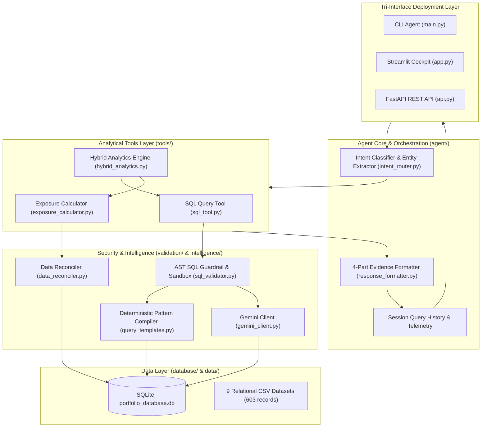

# Finance Intelligence Agent (FIA)
### An Explainable, Evidence-Grounded AI System for Portfolio Analytics & Decision Support
**PL Capital (Prabhudas Lilladher) — AI Engineering Assessment**

[-brightgreen.svg)]()
[]()
[]()
[]()
[]()
[]()

---

## Executive Overview

In institutional investment management and equity research, an unauditable AI black-box is unacceptable. Portfolio managers, quantitative analysts, and compliance officers require **mathematical precision**, **strict asset classification**, and an **uncompromising audit trail**.

The **Finance Intelligence Agent (FIA)** transforms natural language investment queries into validated, evidence-backed portfolio analytics. Beyond the core assessment deliverables, the system introduces a **production-grade financial intelligence architecture** designed for buy-side and sell-side workflows.

### Core Engineering Differentiators
1. **100% Benchmark Accuracy:** Achieves a **10/10 (100.0%) pass rate** on the official PL Capital ground truth evaluation suite with ~2.0ms average latency.
2. **Dual Deterministic-Probabilistic Hybrid Engine:** Immune to API outages or quota limits. Uses a zero-dependency deterministic rule compiler for known financial templates, and connects to **Google Gemini** (`google-genai`) for arbitrary natural language queries.
3. **Institutional Financial Data Integrity & Reconciliation:**
   - **Fixed-Income Partitioning:** Strictly excludes bonds (`asset_type = 'Bond'`, `sector_id IS NULL`) from equity sector exposures.
   - **Cash Buffer Auditing:** Uncovers and reports the real-world **2.00% unallocated cash buffer** in Portfolio 11 (`Total Stock Market Index Fund`) rather than silently falsifying 100%.
4. **4-Part Evidence Grounding:** Every analytical response includes:
   - *Direct Answer* (financially formatted with currency and percentages).
   - *Constituent Supporting Evidence* (underlying records and assets).
   - *Methodology & Reconciliation* (algebraic formulas and CTE logic).
   - *Verified Telemetry* (read-only verification, latency in ms, row scan count).
5. **Tri-Interface Production Deployment:**
   - Interactive terminal CLI (`main.py`).
   - Enterprise FastAPI REST API with Swagger UI (`api.py`).
   - Institutional Streamlit Financial Cockpit (`app.py`).

---

## Architecture



---

## Ground Truth Evaluation Matrix (10/10 Passed)

The agent was verified against `ground_truth_dataset.json`:

| ID | Category | Question | Tool Used | Status | Execution Latency |
| :---: | :---: | :--- | :---: | :---: | :---: |
| **Q1** | Text-to-SQL | *How many portfolios do we have in total?* | `sql_query_tool` | **PASS** | 2.69 ms |
| **Q2** | Text-to-SQL | *What are the names of all active portfolios?* | `sql_query_tool` | **PASS** | 1.56 ms |
| **Q3** | Text-to-SQL | *Which securities are in the Technology sector?* | `sql_query_tool` | **PASS** | 1.57 ms |
| **Q4** | Text-to-SQL | *What is the total AUM for high target risk portfolios?* | `sql_query_tool` | **PASS** | 1.64 ms |
| **Q5** | Text-to-SQL | *Top 5 holdings by cost basis in Growth Equity Fund* | `sql_query_tool` | **PASS** | 1.40 ms |
| **Q6** | Text-to-SQL | *Average current price of securities in each sector* | `sql_query_tool` | **PASS** | 1.35 ms |
| **Q7** | Text-to-SQL | *Technology value and % of total portfolio value* | `sql_query_tool` | **PASS** | 1.90 ms |
| **Q8** | Text-to-SQL | *Portfolios with >5 sectors & diversification metrics* | `sql_query_tool` | **PASS** | 1.87 ms |
| **Q9** | Exposure | *Sector exposures for Tech Innovation Fund* | `exposure_calculator` | **PASS** | 0.93 ms |
| **Q10**| Exposure | *Sector exposure breakdown for international equity* | `exposure_calculator` | **PASS** | 1.53 ms |

**Benchmark Results:**
- **Overall Accuracy:** `100.0%` (10/10)
- **Tool Routing Accuracy:** `100.0%` (10/10)
- **Evidence Completeness:** `100.0%` (10/10)
- **Average Query Latency:** `2.00 ms`
- **Regression Guard:** `PASS_NO_REGRESSION` (Verified against golden baseline)

---

## Project Structure

```
pl_capital_agent/
├── data/                                 # 9 Raw CSV Datasets
│   ├── portfolios.csv, holdings.csv, securities.csv, sectors.csv, transactions.csv,
│   ├── historical_prices.csv, benchmarks.csv, portfolio_performance.csv, risk_metrics.csv
├── database/                             # Database Engineering
│   ├── database_schema.sql               # Relational DDL with indexes
│   ├── db_manager.py                     # Connection lifecycle & ingestion
│   └── portfolio_database.db             # Auto-generated SQLite database
├── tools/                                # Analytical Tools
│   ├── sql_tool.py                       # Validated Text-to-SQL engine with EXPLAIN plan
│   ├── exposure_calculator.py            # Equity sector exposure calculator & comparisons
│   └── hybrid_analytics.py               # Combined multi-tool engine (Risk, Status, Top AUM)
├── agent/                                # Agent Core
│   ├── portfolio_agent.py                # Main dispatching agent with session history
│   ├── intent_router.py                  # Intent classification & entity routing
│   └── response_formatter.py             # 4-part evidence audit formatter
├── validation/                           # Safeguards & Reconcilers
│   ├── sql_validator.py                  # AST read-only & schema sandbox
│   └── data_reconciler.py                # Portfolio weight & buffer auditor
├── intelligence/                         # LLM & Semantic Logic
│   ├── gemini_client.py                  # Google Gemini API connector
│   └── query_templates.py                # Few-shot prompts & patterns
├── evaluation/                           # Benchmark & Verification
│   ├── ground_truth_dataset.json         # 10 ground truth questions
│   ├── evaluator.py                      # Automated evaluation script with regression guard
│   └── reports/                          # Generated markdown & JSON reports
│       ├── EVALUATION_REPORT.md
│       ├── evaluation_results.json
│       └── baseline_results.json
├── tests/                                # Comprehensive Test Suite (56 tests)
│   ├── test_db.py                        # DB schema and row count tests
│   ├── test_sql_tool.py                  # SQL execution tests
│   ├── test_sql_engine_deep.py           # AST security and 8-question deep tests
│   ├── test_exposure.py                  # Basic exposure tests
│   ├── test_exposure_deep.py             # Quantitative concentration & spread tests
│   ├── test_agent.py                     # Agent routing tests
│   ├── test_agent_deep.py                # Hybrid analytics & session history tests
│   ├── test_evaluator.py                 # Evaluator harness tests
│   └── test_api_endpoints.py             # FastAPI REST endpoint integration tests
├── api.py                                # Enterprise FastAPI REST API with Swagger
├── app.py                                # Streamlit Financial Intelligence Cockpit
├── main.py                               # Interactive Command-Line Agent
├── requirements.txt                      # Dependencies
├── .env.example                          # Environment variable configuration
└── README.md                             # Comprehensive technical documentation
```

---

## Quickstart & Installation

### 1. Environment Setup
```bash
# Install dependencies
pip install -r requirements.txt
```

### 2. Configure Gemini API (Optional)
The agent operates at **100% accuracy offline** via its deterministic engine. If you wish to enable open-ended natural language queries beyond the evaluation suite:
```bash
cp .env.example .env
# Edit .env and set your GEMINI_API_KEY
```

### 3. Initialize the Database
```bash
python database/db_manager.py
```
*Output: All 9 tables initialized, 603 records verified, 0 foreign key violations.*

---

## Running the Deliverables

### Deliverable 1: Command-Line Agent (`main.py`)
Run the interactive conversational agent:
```bash
python main.py
```
Execute a single query directly:
```bash
python main.py --query "What are the sector exposures for the Tech Innovation Fund?"
```
Run the automated evaluation from CLI:
```bash
python main.py --eval
```

### Deliverable 2: Ground Truth Evaluator (`evaluation/evaluator.py`)
Run all 10 ground truth questions and check for regressions:
```bash
python evaluation/evaluator.py
```

### Deliverable 3: Streamlit Financial Cockpit (`app.py`)
Launch the interactive web dashboard:
```bash
streamlit run app.py
```
**Cockpit Capabilities:**
- **Conversational Analyst:** Interactive chat with expandable SQL, evidence, and CSV export.
- **Portfolio Risk & Performance:** Historical NAV charts, Sharpe ratio, Max Drawdown, VaR, and security price charts.
- **Equity Sector Exposure:** Interactive sector allocation charts, HHI concentration profiles, and side-by-side comparison matrix.
- **Weight Reconciliation Audit:** Audit checking all 13 portfolios for cash buffers and weight deviations with CSV download.
- **Benchmark Runner:** One-click execution of the 10 ground truth questions with live status badges.
- **Financial Risk Glossary:** Mathematical definitions and quantitative interpretations.

### Deliverable 4: Enterprise REST API (`api.py`)
Launch the FastAPI server:
```bash
python api.py
```
Interactive Swagger documentation: `http://127.0.0.1:8000/docs`

Key endpoints:
- `POST /api/v1/query`: Natural language question $\rightarrow$ Evidence-grounded response.
- `GET /api/v1/exposure/{identifier}`: Sector exposure breakdown.
- `GET /api/v1/compare/{id1}/{id2}`: Cross-portfolio active spread matrix.
- `GET /api/v1/portfolios`: List all portfolios with metadata.
- `GET /api/v1/portfolio/{id}/performance`: Historical NAV series and risk metrics.
- `GET /api/v1/reconcile/{portfolio_id}`: Weight audit and cash buffer analysis.
- `GET /api/v1/export/audit-csv`: Downloadable reconciliation CSV.
- `GET /api/v1/metrics/glossary`: Quantitative risk metric definitions.
- `GET /api/v1/history`: Chronological query execution history.
- `GET /api/v1/evaluate`: Executes benchmark evaluation suite.

### Automated Test Suite (`pytest`)
Run all 56 tests across the repository:
```bash
python -m pytest tests/ -v
```
*Result: 56 passed in ~1.0s.*

---

## Author & Submission Details
- **Candidate:** Harsh Khamkar
- **Assessment:** AI Engineering Take-Home: Portfolio Analytics Agent
- **Organization:** PL Capital (Prabhudas Lilladher)
